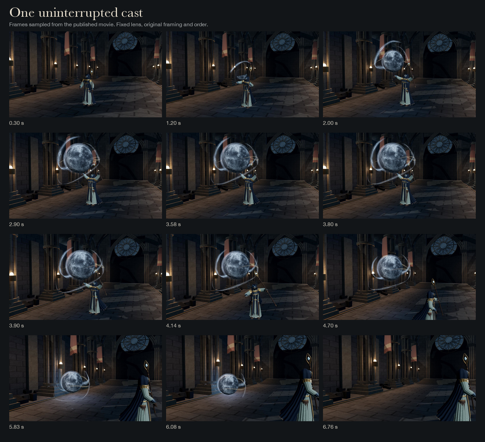

# 样本 01 · 天体降临 · 首版审阅件

**项目负责人已看过本版，要求调整。月体与成形过程、角色动作与交付重量、场景尺度与整体构图三项均有问题。** 更具体的原因和修改优先级留给联合审阅。以下影像、工作台和源码对应同一首版。样本 02 与算子定型均待首样复审通过。

## 先看片

[连续实机录屏 · 带声音 · 7.87 秒](../evidence/01/celestial-descent.mp4) · [录屏原镜头的十二帧](../evidence/01/motion.png) · [成形时的 1080p 原构图](../evidence/01/formation.jpg)

如果只能读图，先从左到右逐行看十二帧。可以先独立写下三件事：哪一刻第一次看出有什么东西在形成；哪一帧身体的变化使你感到它有重量；哪一个建筑或人物细节使你读出了大小和距离。记录具体秒数，再看下方设计意图与实现。

[六时点 × 三机位](../evidence/01/contact-sheet.png) · [同一时刻独立打开四个视觉图层](../evidence/01/layers.png) · [背面、侧面、暗穹、转身、打断与双术](../evidence/01/conditions.png) · [实机观测 JSON](../evidence/01/observations.json)

## 三项退回意见怎么审

| 维度 | 首版的具体取舍 | 请指出的镜头问题 |
|---|---|---|
| 月体与成形 | 0.58、1.64、2.98 秒分别取起势、聚合与成形。月面从低处显露，三条偏轴光带围绕同一个核心，表面保留陨坑。 | 什么时候已经像一颗完成的球？从那里往后，轮廓、暗部和光带还讲述了什么变化？特写和主机位分别看。 |
| 角色动作与交付重量 | 角色从手旁把月体托到上方。3.85 秒月体脱离，角色落回地面，随后独立移动转向。落石声由空间接触触发。 | 比较 3.58、3.80、3.90、4.14 秒的手、胸、骨盆和脚。遮住月体后，仅凭人物能否认出聚势、承重和卸力？声音落在哪一个可见动作上？ |
| 场景尺度与整体构图 | 首版选了近身暗月，最大半径 0.83 米。人物、石柱、窗和地面投影给它提供参照，外景使用另一套天空和地面。 | 近景读出的是头顶器物、贴身投射物，还是有天体压迫感的现象？换到建筑远景，角色、月体和空间各自占据多少注意力？有哪些环境反应能让人读出它的到来与离开？ |

**作者观察，供审阅者质疑。** 主机位里陨坑很好辨认，但明部铺得宽，月面和光带常比施法者的肩手醒目。用建筑远景能估算尺寸，近身尺度能否承载「降临」的意象仍是开放问题。项目负责人只确定了上述三个维度均需调整，未指定主光、姿态、机位或尺寸的具体解法。独立多模态盲审尚无结论。

## 参考意象与首版技术选择

纸面 J05 写的是施法者悬起，多个局部作用域在同一月体周围长成并随它移动。舞台谱要求暗核、偏轴环与薄壳围出负空间。这次把离手前后当作镜头支点，让人能够用手、肩和柱子读出同一个物体何时独立。月面以陨坑大尺度明暗和坑缘细节组织表面，源贴图为项目生成的资产。地形参考可对照 NASA 的月面颜色与高程资料。[J05 世界谱](../../magic_language/corpus/classic-01-07.md#j05) · [J05 舞台谱](../../magic_language/corpus/stage-scores.md#j05) · [NASA CGI Moon Kit](https://svs.gsfc.nasa.gov/4720/)

| 可独立观察的部分 | 首版如何构造 | 同一机位如何核查 |
|---|---|---|
| 核心 | 128 段经向球面写入深度。高度图驱动轮廓微位移，微法线、地貌纹理及按位置变化的覆盖阈值组织表面。 | 单开核心；镜头靠近时看坑缘和暗区，转到背面看轮廓。 |
| 大气层 | 逐像素求视线穿过内外球面的路程，以场景深度截断，再按指数消光、流噪和视角求壳缘亮度。 | 单开包络，对比月面中心与轮廓边缘的厚薄。 |
| 宽光带 | 三条曲带各自使用 12 个骨架点、沿程传播延迟与二阶阻尼。法向沿曲线平行传输，GPU 在固定的 192 × 8 参数网格上扫掠，宽度与扭转随位置变。 | 单开曲带，与主机位、背面和侧面的前后遮挡交叉看。 |
| 星屑与流尾 | GPU 微粒采样收束与环向流场，离体后沿速度方向取八个尾迹采样点。 | 单开粒子，用运动镜头检视流向，和光带层对照密度。 |
| 身体与声音 | 原创 18 骨人形驱动手、法杖和披风。工作台提供六种姿态；本段使用聚势、展开、浮空和释放。五条预烘焙声音分轨承担低频、气流、金属摩擦、释放及碰地，按室内外切换空间混音。 | 有声看片后静音重看交付；工作台可独立看姿态、提前打断和切换内外景。 |

[工作台与输入](../../../game/art_lab/workbench.gd) · [月体、离手及接触](../../../game/art_lab/scenes/celestial.gd) · [表面与光学材质](../../../game/art_kit/materials) · [六种姿态](../../../game/art_kit/choreography/poses.gd) · [声音分轨](../../../game/art_kit/audio/stems.gd) · [原始资产与离线生成工具](../../../tools/art_assets)

## 已观测的工程事实

- Godot 4.5.1、Apple M6、Metal Forward+、Jolt。录屏以引擎固定步电影输出生成，1920 × 1080、30 fps，含游戏内立体声。三机位图板各行用同一个施法时刻，条件图另行切换了环境和事件。图板由实机画面等比缩放并加注。
- 未打断时，3.85 秒交付前后的核心节点身份相同，本次采样的位置跳变为 0 米。只让施法者在 4.00 秒后转身，4.80 秒同一月体的世界位置差为 0 米。
- 石殿内，有限球体沿飞行轨迹对实际碰撞体做 Jolt 扫掠，首次接触记录在 5.98671875 秒。若在 2.50 秒打断，4.80 秒时没有发生交付和碰地。该数据回答的是“是否离手、何时落地”。视听上是否有重量由录像审阅。
- 从雨殿的正常入口通过 F8 进入，时间条、逐帧、视角、图层、双术和六姿态可操作；Esc 返回雨殿，声音总线数从实验室的 5 恢复为原场景的 1。
- **已知录制问题**：本段在碰地声完全衰减前结束。详细日志报告退出时仍持有 `stone_contact.wav` 的播放资源。已发布的 MP4 可完整解码；其收尾仍按负责人看过的原版保留。

本次实机观测覆盖上述工作台、视觉研究和接触。J05 的抽热、奥术支撑失效、世界视线消光、玩家蓄力与计费仍属 DSL 设计范围。高负载 60 FPS、显存预算、跨法术自由组合和艺术算子迁移都需要各自的后续证据。

[在 Godot 中复查的方法](../../../game/README.md#artlab) · [五大标杆的串行审阅约定](../技术美术实验室与升级计划.md)
