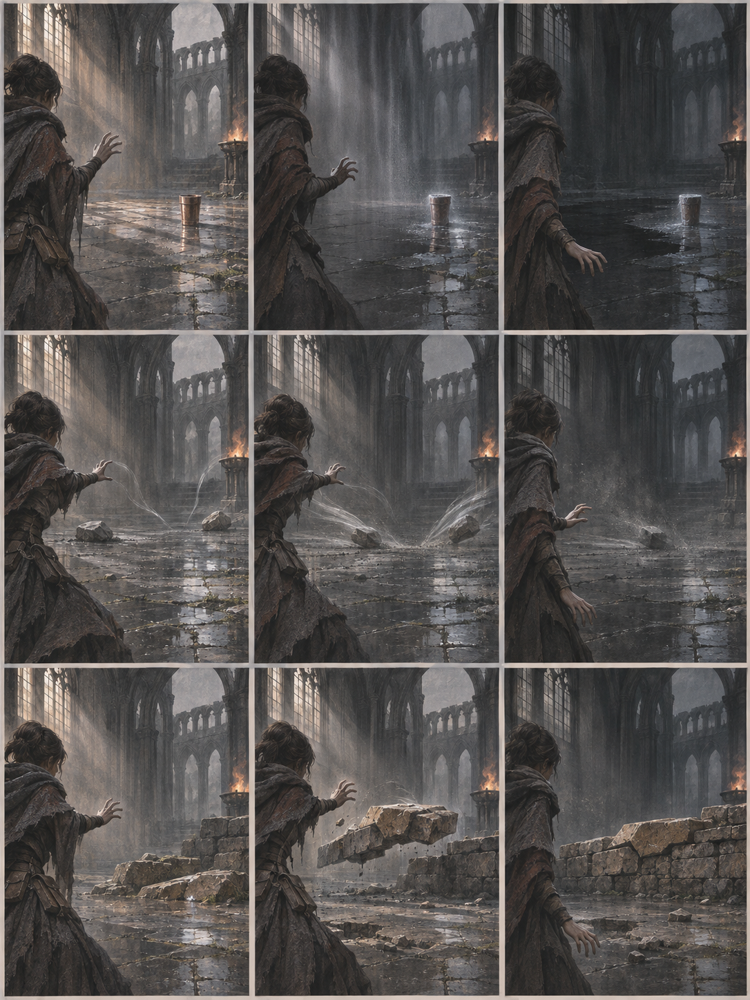

# 天体降临 · 三种可施展的天体现象

P0 · 研究候选 0.1 · 供负责人选择。作品暂名仅用于讨论。首版提供了实机材料、骨架、扫掠与抓拍依据；本页是依据首版退回意见新作的三个方向。已有观测与评议可追至[固定提交的审阅件](https://github.com/fpddmw/magic-3D/blob/b06de8cc0a34d75e99d5ee864df65f902a2a4e47/docs/art_research/reference_breakdowns/01_celestial_descent.md)。

本图为本轮用 ImageGen 生成的构图草图。读中排时以第二格为首次外物偏转；单张图中石块扬起或尘纹弯曲的程度不定义物理合同。底排表达材料留存，是否砸坏墙由接触与承载决定。三排共用机位和石殿，仅为比较设计。整体气质与剪影尚待审定。

## 冷暗天体 · 借一片夜色经过日照处

- **意向与成立。** `{光,藏}→引` 使一处可引导的局部光学域衰减穿越它的光。冷暗复合版明确加入 `{火,逆}`，从实际温物向已取得的有限热汇转移热量。另加以太干涉须独立锚定和付款，本候选只选择光与热。以太容许异常关系，施法者承担两条关系的预算。
- **玩家手上做什么。** 指向合法空间，按住把窄暗域牵过窗光或热物，松手撤去维持。路径与照度改变可见性；墙后物体不会因在域内就向玩家报告。无热汇时热通道失效，仍可用单纯遮光。
- **分镜与声音。** 起手时把亮窗和照在地上的窗格一起入镜。窄暗沿窗格经过，原本耀眼的铜面先失去反光，再因真实降温而可能出现凝露；水汽和温度条件不足则保持干燥。手掌逐步合拢，布料摩擦声压低，撤手后窗格立刻回来，铜的温度留在已经到达的位置。
- **用途与边界。** 可穿过眩光、让局部视线衰减、冷却可接触的热物。没有动量或石料交付。适于优先研究多通道同域、细微可读性与真实遮挡；要同步证明视线衰减和热汇才能认可完整复合版。与[经典 J05](../../../magic_language/corpus/classic-01-07.md#j05)分开保存。

## 重力天体 · 沉星（推荐）

- **意向与成立。** `{重力,聚}→引`，玩家锚定“向我选的一处汇集附近有质量的对象”。「引」作用于场中心；有限的奥术支撑支付局部加速度及反作用。定向不赋予切向旋转，场中心无材料质量。选它是因为同一次控制既有直观的空间后果，也给艺术留下自由：玩家能读出「往哪里」，无需把引力画成固定物件。
- **按住。** 正常过肩机位能看到前脚、拱柱脚和所选区域。施法者错步站稳，用法杖定方向，指尖与前景的细银纹由疏到密，中央保持一段空隙。可在限速范围内调瞄点。此时只有储备、输入和预备演出；原本横滚的石片继续自然滚动。在遮住全部预备视觉的版本，受体轨迹应与未施法相同。
- **松手交付。** 责任达标才锁定合法中心。玩家手和肩先卸力，外缘的薄片状纹理沿局部坐标先后折向空处。靠近中心的一枚横滚石片实际转弯，远处另一枚只略偏，画面可通过两条路径夹出的留白读出中心。暗部保留透见建筑的间隙。角色全身保持足底接地，前景手退出重心，镜头维持玩家朝向。
- **沉降与余韵。** 中心沿已锁位置向下移动，在地面净空处停住，场在责任期内继续作用。低频声跟随已建立的场；石块撞柱才有石响。到期或断供后额外引力结束，真实石块仍按所得速度、碰撞与摩擦运动。术末最重要的一拍留给一枚滚出空处的石片，而非场心的亮灭。
- **三处普通现场（纸面预期）。** 空旷露台也能定位和交付，地面弱纹与身体提示保留，实物回执可为零。石廊可把横越路口的落石偏向一旁，入域前、出域后分别沿自然轨迹前进。庭院可牵动有质量且已接入力学的其他魔法造物，与普通落石竞争同一预算；纯光影无受力资格。该候选还允许缺少操控端、被打断和预算不够时有可读的失败。

## 动能与物质天体 · 借石成砣

- **意向与成立。** `{土,聚}→引`，锚定“借现有石料组成一份可以交出去的重量”。取得有限材料及搬运权限，以可承载约束临时束成偏心长形；记录各块原身份、质量和接触面。没有合格石料时告知缺来源；付费具现另作构筑。
- **输入与兑现。** 按住选择可借的石块并聚合，肩胯向负荷反向调整；松手沿合法方向交付有限冲量，支点承担反力。途中遇障碍按实际碰撞处理，约束超载才散开。未就位就中断，撤支撑后已抬高的材料自然落下。
- **分镜与声音。** 给地面一块有独特缺角的楔石留下特写；它抽出时原处露出浅色压痕。两块不同形状的石料在空中错位扣合，重心低悬；接触声先闷后脆。交付镜头跟玩家的肩线，投出的长砣短暂遮住一道窗光。碎裂依赖实际碰撞阈值。收尾回到地面，缺角石仍能被下一次施法选中。
- **用途与边界。** 可以移开塌方、将重物送至承台或撞击现有结构；材料完全缺席时无法施展。把此案作为首题会同时检验借物、复合约束、反作用和物质留存，适于优先讨论质量与不可逆后果。

三案的辨别题是「拿掉施法者以后留下什么」。冷暗案留下已转移的热；重力案留下已经获得的运动；物质案还留下可再次借取的一份材料。改变色板不会改变这三个答案。

**待选决定。** 建议优先试重力案，并采用“聚势可指引、松手提交后首次作用”的锚。这是作者对交互的推荐，不把全部「聚」「引」构筑固定成此解释。若负责人更希望玩家驾驭冷寂的多通道月体或亲手送出一份真实重量，另外两案各自成立，后续配方应随之重写。推荐案随附[完整候选源谱](recipe.json)与[映射、编译知识和迁移](mapping.md)。
