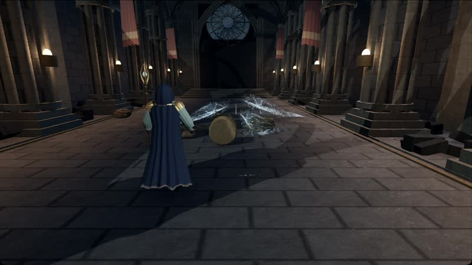

# 重力天体《沉星》第一次交互实机记录 · 已退回

2026-11-28。负责人选择了重力方向，看到实现后指出，画面读起来像一次推拉前后加上粒子，首版月亮反而更有意义。该方向的联合研究已暂停。这里保留被评议的实现、原始镜头和物理记录，供后来者核对这次偏差。

**先看成片。** [正常第三人称带声窗口录屏（12.4 秒）](../../evidence/gravity/third-person.mp4)。前段是游戏入口，约 5.5 秒进入研究场，约 8.5 秒看松手后的构图。Apple M6，Godot 4.5.1，Forward+ / Metal，Jolt。窗口实时采集，右键按住和松开由回放器送入同一游戏视口。未进行真人操作盲测。可与[原分镜的中排](storyboard.png)及[首版月体的连续录屏](../../evidence/01/celestial-descent.mp4)对看。

## 查到了什么

- [手工实验谱](../../../../game/art_lab/field_study/recipes/infall.json)同时提供世界作用和舞台参数；录屏记录中的两者持有相同源文件摘要。按住只更新目标和预留，成功松手开始有限时间的向心作用。打开游戏后从雨殿按 F9，可用鼠标转向、按住和松开右键，空格可打断。
- 同一初态的固定步记录中，按住发生在第 56 步。截至第 151 步，成功施法组和无施法组所记各物体的速度逐项相同，柱鼓仍以约 1.18 m/s 横滚。第 152 步松手并首次提交冲量。第 226 步，柱鼓与无施法组的位置相距 0.882 m。每秒 60 个物理步。
- 未达门槛早松或在准备中打断，均未提交引力。已过门槛的提前松手在第 101 步交付。露台和空场用同一谱，后者有成立事件、无受体冲量。「归砂庭」保留相同世界视图，换贴地砂纹；「分砂径」改变径向符号，使力向外。可下载[逐步记录 ZIP](../../evidence/gravity/physics-traces.zip)，其中固定步的 19 组记录与实际窗口录屏的记录分别保存，各条都包含输入、状态、物体位置速度、冲量与舞台事件。

## 为什么退回

原分镜让玩家先从手势和远近参照察觉方向，再从相隔的物体轨迹中读出一个下沉的中心。首版月亮虽有尺度和动作问题，至少给了天体一个能与拱顶和人物比较的形象。这次成片的重心缩在人物前方几片亮纹上。柱鼓的偏转能证明局部场改变了运动，画面却没有建立天体的尺度、降临的重量或废殿空间整体向一处收束的感觉。

当前实验谱让作者填写扇片角度、宽度、色彩和流速，扇面的生成方式预先写在着色器里。调整这些参数可以换一种外观；作品如何成形、建筑和身体如何参与、视觉重心怎样移交，仍缺少相应的可编排表达。「归砂庭」提供同一力学作用换表面的对照，跨意象创作能力仍待证明。

本次有作者配方、局部后端、录屏、物理轨迹和负责人的退回意见。重力天体的整体创作、相应的 DSL 深化与编译知识、跨意象的有效复用均未交付。没有模型生成或玩家实测结论。[原设计](design.md)与[纸面技术映射](mapping.md)保留原版，便于逐项比对。
