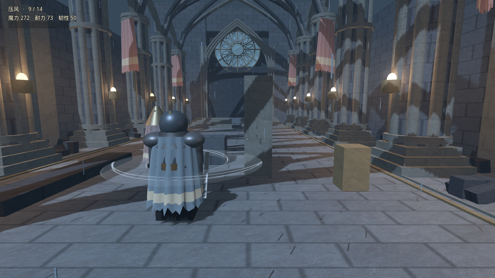

# 雨殿 · 现象、演出与组合迁移

2026-11-27。游戏入口为 Godot 4.5.1 的 `game/project.godot`。雨殿使用 Forward+、Jolt 和本地已准入配方，战斗过程中模型调用数为零。[进入与操作](../../game/README.md)



## 同一个世界里的两项验收

**承载与留存。** Jolt 碰撞观测到承重面实际托住 3 单位负荷。将同一物体的负荷增至 15，超过该配方的 10 单位承载能力，承重面破裂，重物下落。投出的石块在撤去控制的同一时刻，实例 ID、RID、变换、线速度、角速度、损伤与有效边逐项一致。随后自然物理继续改变其位置。游戏也走这条入口。[实测断言与观测值](evidence/jolt.json)

**新配方迁移。** 在看见候选前登记「土、聚、引」和“以目标为心向内牵动周围实体”，并冻结可用的世界作用代码。独立模型在空目录收到符文、锚点、能力和机器契约。第一次试写以具现土核派生另一个本性的场，违反来源合同。一次通用诊断修正后得到「聚土回牵」。修正版分别具现土核与实际压力场。施法后，四个距中心 2 米的对象从不同方向向内运动，其中石柱因完整性耗尽而解除固定，另一实体在交付时仍属另一项施法。将同一配方的冲量方向从 `radial_in` 改为 `radial_out`，四个对象都向外运动。控制副本经同一个准入器、报价器和游戏加载入口。动作、世界规律和美术均按能力分派。[冻结提交](https://github.com/fpddmw/magic-3D/commit/b8e61805e238094a79e298362d4d995c9adeed8b) · [事前预期与模型记录](../../game/data/magic_v0_3/trials) · [反向对照](../../game/data/magic_v0_3/slice/outward_control.json)

## 当前覆盖

| 通道或责任 | 现场与可重放结果 |
|---|---|
| 压力、局部重力与方向 | 压风蓄力不足或中断时不交付，过阈值松手当刻交付。离线对照区分普通墙对压力、光线与引力的影响。力场支持瞄点、目标、向内、向外和绕世界上轴的切向。 |
| 水与材料 | 四段材料在一条有限材料图上；断边阻止结冰前沿，接回后前沿可以继续。液态水渠可穿过，已凝固的同一段获得实体碰撞。 |
| 热与电 | 相邻热端共享有限热量，等质量测试从 10 和 0 演化，和保持 10。导电按有效电边传递，断边另一侧的电荷保持原值。 |
| 光学、感应与寄托 | 穿过有限光幕的测线透过率为 0.25，旁路为 1，撤场后恢复。受监视区的扰动回到绑定接收端。寄托光源从现场器物扣费，断联后停止供给并撤场。 |
| 动作 | 移动、翻滚、正面格挡、韧性失衡和近战接入同一角色。回归检查翻滚支出、格挡耗耐力并保住韧性、受击失衡、施法中断。 |
| 表现 | 四个载体各有着色入口，首批适配覆盖片岩、晶质和银雾。过程拍点驱动形变、音效与角色姿态。真实命中才触发命中提示。单时刻主次权重的平滑交接在运行时完成。 |
| 材料扩展能力 | 定向投射和原位留存有 Jolt 对照；有限生长、逆相变、碎裂有离线操作测试和 Godot 执行入口。本轮实机断言没有逐个覆盖其全部参数与组合。 |

法坛读解、模型准入、运行时效果与人的评价分别留证。两次独立试构共三次模型调用，重力改向在首答准入，向心构筑经一次修正。它们带有强语义锚，且只保存了设计方的事前预期。要测 80%–90% 玩家预期吻合度，仍需要玩家在看配方前记录预期，看确定性读解与实机结果后给出选择。两条记录的 `preference` 均为空。两次试构不能推断长期首答成功率或所有符文的覆盖率。

## 复现

在仓库根目录执行。首次导入前 Godot 需要读取石材纹理。下列实机校验命令会自动导入，并在脚本异常、缺少汇总或任何断言失败时返回失败。

```sh
uv run --isolated --with-requirements tools/magic_dsl_v0_3/requirements.txt python -m unittest discover -s tests -v
python3 -m tools.magic_dsl_v0_3.engine_check godot
godot --path game
godot --path game --rendering-driver metal --resolution 1920x1080 --disable-vsync -- --hall-bench
```

目录重新生成与三账查询使用同一套 Python 依赖。生成后应一同提交目录和配方变更。

```sh
python -m tools.magic_dsl_v0_3.catalog
python -m tools.magic_dsl_v0_3 budgets game/data/magic_v0_3/slice/cast_stone.json
python -m tools.magic_dsl_v0_3.model_trial --help
```

独立模型实验入口接受一个从标准输入读取提示、向标准输出写出 JSON 的适配命令，以及在实验前明确记录的预期。可以选择一次诊断修复；失败候选、修正、提示摘要与离线观测保存在新的结果目录。玩家偏好需实际采集。小模型后训练尚未启动。

## 美术与评审

本轮搭建一座挑高石殿。柱簇、拱肋、玫瑰窗、雨、石面湿度、破损织物与角色部件在三维场景中渲染。石材贴图使用内置 imagegen 生成，其余建筑、着色、服饰几何与声音由项目代码生成。[石材资产](../../game/art_kit/slate.jpg)

<details><summary>石材生成提示原文</summary>

Use case: photorealistic-natural. Asset type: seamless square PBR diffuse base-color texture for a 3D ruined gothic cathedral. Directly overhead orthographic macro scan of continuous ancient blue-grey sedimentary slate stone, mottled charcoal patches, fine angular cool mineral fissures, subtle muted olive patina in hairline crevices, soft worn grit, stratified flakes. One homogeneous material over the entire square, physically plausible, mid-grey value range, no tile grout, no large isolated feature, no cast shadows, no highlights or lighting gradients, no borders, no objects or text. Opposite edges tile seamlessly. It will be sampled across wet ashlar and chipped carved columns with procedural joints.

</details>

动作重量、遮挡下的威胁可读性、实际听感和未见组合的审美需要人工实机评审。当前采样限于一座雨殿，开阔外景、Windows/Vulkan 中端独显、长时间战斗与大规模并发尚待验收。


## Apple M6 帧时间

Godot 4.5.1，Metal 3.2，Forward+，Jolt，真实渲染目标 1920 × 1080。每次重新启动，预热 75 帧，记录 300 个绘制完成间隔。关闭垂直同步，包含哨兵、蓄力、释放、投射、承重、翻滚与近战。表中显存取 Godot 渲染器计数器的采样峰值。

| 批次 | P50 | P95 | 最慢帧 | 超过 16.67 ms | 显存峰值 |
|---|---:|---:|---:|---:|---:|
| 1 | 9.61 ms | 21.62 ms | 31.64 ms | 19 / 300 | 171.4 MiB |
| 2 | 9.63 ms | 17.21 ms | 32.79 ms | 18 / 300 | 171.1 MiB |
| 3 | 6.33 ms | 19.35 ms | 32.99 ms | 18 / 300 | 171.4 MiB |

**稳定 60 FPS 门禁仍开放。** 最终三批 P95 均超过 16.67 毫秒。初轮战斗采样曾出现超过 1 秒的长帧。已将声音生成移入加载期、共享几何、预热载体着色、简化石面的逐像素计算并收窄动态阴影。Metal 返回的 viewport GPU 分项时间为零，无法据此判断剩余抖动的 CPU/GPU 归属。切片采样的显存峰值低于 2.5 GB；长时间战斗和其他硬件仍需独立测量。[各批次实测与早期对照](evidence/metal.json)
